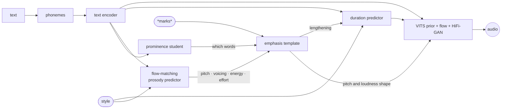

<div align="center">

# 🎶 x-vits

**Expressive prosody for Piper voices.**
Styles, emphasis and natural intonation for fast, local VITS text-to-speech, in about 25M parameters.

`pip install` · one command per voice · ONNX out · runs on a CPU

</div>

---

[Piper](https://github.com/rhasspy/piper) voices are small, fast and clear, and they read
everything in the same careful, slightly flat way. The audio quality is already there. What's missing is
**prosody**: the melody, rhythm and emphasis that tell you *how* something is said.

x-vits is an incremental recipe on top of an existing Piper/VITS checkpoint. It teaches the voice to
take intonation as an input, then trains small models that predict that intonation from text,
optionally in a chosen **style** and with **emphasis** on the words that matter.

```text
"Who's more miserable than *her*?"   --style confused
"Ask and you shall receive!"          --style happy     (emphasis predicted automatically)
```

## 🤗 Try it in 30 seconds

A ready-made expressive English voice (Expresso ex02, six styles) is on the Hugging Face Hub:
**[fdemelo/x-vits](https://huggingface.co/fdemelo/x-vits)**, with audio samples comparing plain Piper and x-vits for every style.

```python
from xvits.runtime import XVits
import soundfile as sf

voice = XVits.from_pretrained("fdemelo/x-vits")
audio = voice.synthesize("I never said *she* stole my money.", style="happy")
sf.write("hello.wav", audio, voice.sample_rate)
```

(Needs `pip install "x-vits @ git+https://github.com/femelo/x-vits"` and `libespeak-ng1`. The voice is CC BY-NC 4.0, inherited from Expresso.)

## ✨ What you get

- 🎭 **Speaking styles.** If your data has style labels (happy, sad, whispering, …), pick one at synthesis time, and exaggerate it if you like.
- 💥 **Word emphasis, two ways.** Mark words with `*asterisks*`, or let a 1.2M-parameter student predict which words to stress. The emphasis follows the shape found in real speech: pitch rises into the stressed syllable, peaks, then releases below baseline, the syllable stretches and relaxes, and the word gets a little louder.
- 🌊 **Flow-matching prosody.** A conditional flow-matching model *samples* pitch, voicing, energy and vocal effort per phoneme, so every sentence isn't averaged into the same contour.
- 📣 **Vocal effort.** Shouting is not just louder: the voice gets brighter and more pressed. x-vits measures that per phoneme (energy at 2–5 kHz relative to 0–1 kHz) and learns it per style, so an angry sentence sounds strained from the first word to the last, even on loudness-normalised data.
- 🤫 **Whispering.** Styles that are (nearly) unvoiced in the recordings are detected from the data and rendered without voicing.
- 🎚️ **Style-aware timing.** The voice's own duration predictor learns styles too: sad slows down, enunciated takes its pauses.
- 🔁 **One recipe for any voice and language.** `xvits-train` turns an LJSpeech-style folder and a Piper checkpoint into an expressive voice. No labels are needed: emphasis and prominence are learned from the recordings themselves. The pitch range adapts to the speaker, including shouting, and evaluation picks the Whisper model for the voice's language.
- 📦 **ONNX export with a tiny runtime.** Five graphs plus a numpy driver. The export is verified against PyTorch end to end (max difference ≈ 1e-5).
- 🪶 **Still small and fast.** About 25M parameters at inference, against Piper medium's 16M. The ONNX runtime runs faster than real time on 4 CPU threads: real-time factor 0.6, or 0.24 with `--steps 4`.

## 🎧 Results

On one expressive English speaker ([Expresso](https://speechbot.github.io/expresso/) `ex02`, 2.2 h,
six read styles), held-out sentences:

| | pitch follows recording¹ | timing follows recording | word errors² | UTMOS³ |
|---|---|---|---|---|
| Piper voice, fine-tuned | 0.37 | 0.30 | 1.7 % | 4.08 |
| x-vits 0.1 | 0.37 | 0.39 | 2.1 % | 4.01 |
| **x-vits 0.2** (vocal effort, wider pitch range) | **0.40** | 0.37 | 3.6 % | 3.86 |
| x-vits 0.2 voice, given the *real* prosody | 0.92 | 0.74 | 3.9 % | 3.89 |
| the recordings themselves | | | | 4.12 |

Both automatic scores prefer calm read speech. UTMOS rates the speaker's own laughing takes 2.49, and
x-vits 0.2 loses most of its UTMOS where it got more expressive: happy and laughing. In informal
listening, 0.2 improved the extremes (happy, sad) and kept the other styles as good. Judge for yourself on the
[model card](https://huggingface.co/fdemelo/x-vits), which plays both versions next to the recordings.

| Emphasis on a marked word (x-vits 0.1) | pitch peak | lengthening |
|---|---|---|
| recording | +5.3 st | ×1.41 |
| x-vits, emphasis off | +2.3 st | ×1.06 |
| x-vits, emphasis on | **+4.6 st** | ×1.11 – ×1.25 |

| Which word carries the main stress? (no marks) | agreement with the recording |
|---|---|
| random word | 15 % |
| "last word" rule | 34 % |
| the same speaker, same text, another style | 36 % |
| **x-vits prominence student** | **42 %** |

### 🇩🇪 German: Thorsten, eight emotions

The recipe validated end to end on a second language with no changes to the defaults:
[Thorsten-Voice Piper-Scratch](https://huggingface.co/Thorsten-Voice/Piper-Scratch) (trained from scratch on
neutral speech) plus Thorsten's own [emotional dataset](https://www.openslr.org/110/) (CC0, 300 sentences in
each of neutral, amused, angry, disgusted, sleepy, surprised, drunk and whispering, 2.9 h). The dev set holds
out 15 whole sentences in all eight emotions.

| | pitch follows recording¹ | timing follows recording |
|---|---|---|
| Piper voice, fine-tuned | 0.21 | 0.24 |
| **x-vits** | **0.34** | **0.30** |

| Vocal effort (2–5 kHz vs 0–1 kHz, dB) | angry | sleepy | whisper |
|---|---|---|---|
| recording | −19.9 | −23.7 | −0.5 |
| Piper voice, fine-tuned | −23.1 | −22.3 | −22.9 |
| **x-vits** | **−21.2** | **−23.6** | **−1.3** |

The fine-tuned Piper voice reads all eight emotions in the same voice; it cannot whisper or shout.
UTMOS is not reported here: it is trained on English and rates Thorsten's own recordings 2.5 on average
(whispering 1.25), so it cannot rank naturalness for this voice.

<sub>¹ Correlation of the synthesised pitch contour with the real recording of the same sentence, on 129 held-out sentences, averaged over two seeds (the voice cannot know the exact take, so this is a lower bound on naturalness). ² Whisper WER (small.en for English, large-v3-turbo otherwise). ³ Automatic MOS; it rates audio quality, not prosody. Design choices were also guided by informal (mostly blind) listening tests with a single listener. Treat those as anecdotal, and run your own.</sub>

### What's new in 0.2

- **Vocal effort** as a fourth prosody feature: brightness of voiced sounds, bridged across consonants and pauses like pitch, predicted per style.
- **Pitch range** that covers shouting and excited speech (it used to clip at the speaker's median × 1.9).
- **Voicing tied to the phonemes**: no more blips from a voiced *k* or an unvoiced vowel.
- **Loudness** in the emphasis shape, and separate timing / pitch / energy / effort settings.
- **Whispering** detected from the data and rendered unvoiced.
- **Validated in German** (Thorsten-Voice), with language-aware evaluation.

Voices exported with 0.2 need the 0.2 runtime; 0.1 voices still load.

## 🧠 How it works



The recipe builds this one stage at a time, starting from a checkpoint you already have:

| stage | what it adds | trains | time on 2 h of data |
|---|---|---|---|
| `finetune` | your voice, from a Piper base | VITS | ~1¾ h (compiled) |
| `prosody` | per-phoneme duration, pitch, energy and vocal-effort targets, aligned with the voice itself | nothing | minutes, CPU |
| `voice` | a prior that *listens* to pitch, energy and effort (zero-initialised, so nothing breaks), interpolated to frames | VITS | ~1 h |
| `predictor` | OT-CFM model that samples prosody from text (+ style) | 7.8M | ~10 min |
| `durations` | style-aware stochastic duration predictor | SDP only | ~5 min |
| `prominence` | which words to stress, learned from the recordings | 1.2M | ~2 min |
| `template` | the average emphasis shape (pitch, duration, loudness) anchored on the stressed vowel, per style | a few numbers | seconds |
| `eval` | dev-set synthesis, pitch/timing/WER/MOS vs the fine-tuned baseline | | minutes |

A few design choices that made the difference:

- **Zero-initialised additions.** Every new input to the voice starts at zero, so each stage starts from exactly the previous voice and can only improve on it.
- **Prosody as a distribution.** A regression model predicts the average, and an average intonation sounds flat. Flow matching samples a specific, plausible reading instead.
- **Emphasis anchored on the stressed syllable,** not spread over the word. Measured from the stressed vowel, emphasis in real speech is a rise, a peak and a release below baseline. Measured by position in the word, it averages out to a flat plateau.
- **Effort, not level.** Datasets are usually loudness-normalised per file, so "loud" survives only in the spectrum. Thorsten's angry takes are no louder than his amused ones, but their vowels are 6 dB brighter than neutral ones. Spectral tilt per phoneme captures that.
- **A pitch range that fits the speaker.** Pitch is tracked in a range estimated from the data. A range from the median alone clipped shouted speech at the ceiling, so the voice learned a tamer angry; the upper bound now covers the high end of every style.
- **Labels from the audio.** Word prominence (pitch peak plus vowel lengthening relative to that vowel's average) agrees with human emphasis marks 54 % of the time, against 14 % by chance. That gives every voice prominence labels for free.

## 🚀 Quickstart

```bash
# system dependency for phonemization
sudo apt install libespeak-ng1        # macOS: brew install espeak-ng

git clone https://github.com/femelo/x-vits && cd x-vits
pip install -e ".[eval]"              # drop [eval] to skip UTMOS/Whisper
```

**Data.** An LJSpeech-style folder: `wavs/<id>.wav` plus `metadata.csv` with `id|text` (extra
columns are ignored and the last column is the text). Words may carry `*emphasis*` marks.

**Train** (one GPU; finished stages are skipped when you rerun the same command, and an interrupted stage starts over):

```bash
xvits-train \
  --dataset data/my_voice \
  --base-ckpt piper/en_US-lessac-medium.ckpt \
  --out runs/my_voice \
  --compile --export
# with style labels encoded in the ids, e.g. "spk_happy_0042":
#   --style-regex '^spk_([a-z]+)_'
```

**Speak** with the exported voice, with no PyTorch needed:

```bash
xvits-speak --model runs/my_voice/10_export/onnx \
  --text "I *really* didn't expect that." --style happy --out hello.wav
```

```python
from xvits.runtime import XVits
import soundfile as sf

voice = XVits.from_pretrained("runs/my_voice/10_export/onnx")   # local dir or a Hub repo id
audio = voice.synthesize("Who's more miserable than her?", style="confused")  # emphasis predicted
sf.write("out.wav", audio, voice.sample_rate)
```

Want a quick end-to-end check before a real run? Add `--quick` (tiny epochs and steps, no MOS models).

**Data tips.**
- Normalise loudness per file and leave ~150 ms of silence at both ends; files cut hard at the speech boundaries teach abrupt onsets.
- Denoising is rarely worth it on clean recordings: it changes the timbre relative to the base voice.
- If the same sentences are recorded in several styles, hold out *whole sentences* with `--dev-list`, or the dev set leaks into training.

Example configs: [`configs/expresso_ex02.sh`](configs/expresso_ex02.sh) (English) and [`configs/thorsten_emotional.sh`](configs/thorsten_emotional.sh) (German).

## 🎛️ Knobs

| | where | effect |
|---|---|---|
| style | `--style NAME` | one of the voice's styles; none gives a neutral mix |
| style strength | `style_strength=` / `--style-strength` | one dial for the style exaggeration: 0 none, 1 the voice default, 2 double |
| style exaggeration | `guidance=` / `--guidance`, default from `pp_guidance` | `"timing,pitch,energy,effort"`; default `"1.0,2.0,4.0,1.0"` |
| emphasis strength | `emphasis_scale=` / `--emphasis-scale` | multiplies the emphasis shape (pitch peak, lengthening, loudness); 1.0 = the average real emphasis, default 1.5 |
| emphasis source | `--emphasis auto\|marked\|none` | auto uses marks if present, otherwise the student |
| pace | `--length-scale` | >1 is slower |
| variety | `temperature=` / `--temperature`, default from `pp_temperature` | `"timing,pitch,energy"`; default `"0.8,0.7,1.0"`; higher is livelier but riskier |
| whispering | `unvoiced_styles` | styles rendered without voicing; set by the recipe from the data |
| voicing | `voicing_fix` | voicing follows the phonemes (default on) |

The PyTorch path (`python -m piper_train.eval.synthesize`) exposes everything, including the learned
emphasis models, stage-by-stage ablations and real-prosody resynthesis. See `xvits.Bundle.synth_args`.

## 📦 Exported model

| graph | role | size (fp32) |
|---|---|---|
| `encoder.onnx` | phonemes → text states | 25 MB |
| `predictor.onnx` | one flow-matching step (the runtime runs 16 midpoint steps) | 31 MB |
| `durations.onnx` | stochastic duration predictor | 2.5 MB |
| `acoustic.onnx` | prior, length regulation, flow, vocoder | 36 MB |
| `prominence.onnx` | emphasis student | 5 MB |

Speed on 4 CPU threads (onnxruntime, real-time factor, lower is faster): **0.60** with the default 16
predictor steps, **0.42** with 8, **0.24** with 4 (`--steps 4`). Going from 16 to 4 steps changes the
predicted pitch by about 0.1 semitone on average. Style exaggeration doubles the predictor's cost;
everything else is a single pass.

Exported voices are **not** drop-in files for Piper's C++ runtime, because the prosody loop lives in
`xvits.runtime`. The graphs are plain ONNX, though, and the runtime is about 200 lines of numpy, easy
to port.

## ⚠️ Limitations

- Single speaker, single language per voice: that's the design. Multi-speaker checkpoints aren't supported yet.
- Styles need labels. Emphasis and prominence don't.
- The base checkpoint must use the same phoneme set as your data (any eSpeak language works).
- Voices trained on Expresso are **CC BY-NC 4.0**, so not for commercial use. Check your data's license.
- The numbers above come from one speaker. Please share yours!

## 🗂️ Layout

```text
src/xvits/            recipe (xvits-train), bundle, ONNX export (xvits-export), runtime (xvits-speak)
src/piper_train/     Piper's VITS trainer, extended:
  vits/              prosody-conditioned prior, frame-level prosody, SDP conditioning hook
  prosody/           extraction, flow-matching predictor, style SDP, emphasis, prominence, template fit
  eval/              synthesis, UTMOS, Whisper WER, prosody metrics
tests/               unit tests (CPU)
```

## 🙏 Acknowledgements

Built on [Piper](https://github.com/rhasspy/piper) by Michael Hansen and [VITS](https://github.com/jaywalnut310/vits)
by Jaehyeon Kim et al. Flow matching follows Lipman et al. (2023) and Tong et al. (OT-CFM).
Expressive data: [Expresso](https://speechbot.github.io/expresso/) (Nguyen et al., 2023) and
[Thorsten-Voice](https://www.thorsten-voice.de/) by Thorsten Müller (CC0). See [NOTICE.md](NOTICE.md).

## 📄 License

MIT. See [LICENSE](LICENSE). Trained voices inherit the license of their data and base checkpoint.
