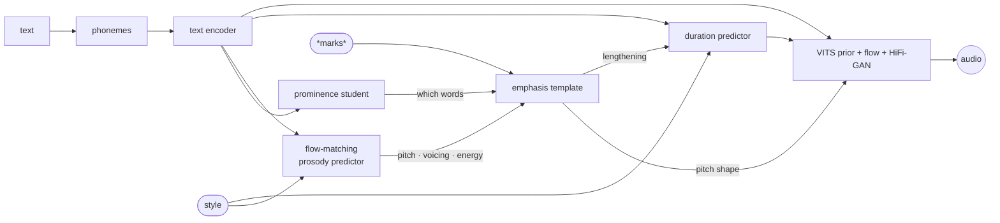

<div align="center">

# 🎶 Lilt

**Give your Piper voices a lilt.**
Styles, emphasis and natural intonation for fast, local VITS text-to-speech, in about 25M parameters.

`pip install` · one command per voice · ONNX out · runs on a CPU

</div>

---

[Piper](https://github.com/rhasspy/piper) voices are small, fast and clear, and they read
everything in the same careful, slightly flat way. The audio quality is already there. What's missing is
**prosody**: the melody, rhythm and emphasis that tell you *how* something is said.

Lilt is an incremental recipe on top of an existing Piper/VITS checkpoint. It teaches the voice to
take intonation as an input, then trains small models that predict that intonation from text,
optionally in a chosen **style** and with **emphasis** on the words that matter.

```text
"Who's more miserable than *her*?"   --style confused
"Ask and you shall receive!"          --style happy     (emphasis predicted automatically)
```

## ✨ What you get

- 🎭 **Speaking styles.** If your data has style labels (happy, sad, whispering, …), pick one at synthesis time, and exaggerate it if you like.
- 💥 **Word emphasis, two ways.** Mark words with `*asterisks*`, or let a 1.2M-parameter student predict which words to stress. The emphasis follows the shape found in real speech: pitch rises into the stressed syllable, peaks, then releases below baseline, and the syllable stretches and relaxes.
- 🌊 **Flow-matching prosody.** A conditional flow-matching model *samples* pitch, voicing and energy per phoneme, so every sentence isn't averaged into the same contour.
- 🎚️ **Style-aware timing.** The voice's own duration predictor learns styles too: sad slows down, enunciated takes its pauses.
- 🔁 **One recipe for any voice.** `lilt-train` turns an LJSpeech-style folder and a Piper checkpoint into an expressive voice. No labels are needed: emphasis and prominence are learned from the recordings themselves.
- 📦 **ONNX export with a tiny runtime.** Five graphs plus a numpy driver. The export is verified against PyTorch end to end (max difference ≈ 1e-5).
- 🪶 **Still small and fast.** About 25.5M parameters at inference, against Piper medium's 16M. The ONNX runtime runs faster than real time on 4 CPU threads: real-time factor 0.6, or 0.24 with `--steps 4`.

## 🎧 Results

On one expressive English speaker ([Expresso](https://speechbot.github.io/expresso/) `ex02`, 2.2 h,
six read styles), held-out sentences:

| | pitch follows recording¹ | word errors² | UTMOS³ |
|---|---|---|---|
| Piper voice, fine-tuned | 0.35 | 1.2 % | 4.08 |
| **Lilt** (style + predicted prosody) | **0.44** | **0.6 %** | 4.04 |
| Lilt voice, given the *real* pitch | 0.94 | 2.3 % | 3.97 |

| Emphasis on a marked word | pitch peak | lengthening |
|---|---|---|
| recording | +5.3 st | ×1.41 |
| Lilt, emphasis off | +2.3 st | ×1.06 |
| Lilt, emphasis on | **+4.6 st** | ×1.11 – ×1.25 |

| Which word carries the main stress? (no marks) | agreement with the recording |
|---|---|
| random word | 15 % |
| "last word" rule | 34 % |
| the same speaker, same text, another style | 36 % |
| **Lilt prominence student** | **42 %** |

<sub>¹ Correlation of the synthesised pitch contour with the real recording of the same sentence (the voice cannot know the exact take, so this is a lower bound on naturalness). ² Whisper-small WER. ³ Automatic MOS; it rates audio quality, not prosody. Design choices were also guided by informal (mostly blind) listening tests with a single listener. Treat those as anecdotal, and run your own.</sub>

## 🧠 How it works



The recipe builds this one stage at a time, starting from a checkpoint you already have:

| stage | what it adds | trains | time on 2 h of data |
|---|---|---|---|
| `finetune` | your voice, from a Piper base | VITS | ~1¾ h (compiled) |
| `prosody` | per-phoneme duration, pitch and energy targets, aligned with the voice itself | nothing | minutes, CPU |
| `voice` | a prior that *listens* to pitch and energy (zero-initialised, so nothing breaks), interpolated to frames | VITS | ~1 h |
| `predictor` | OT-CFM model that samples prosody from text (+ style) | 7.8M | ~10 min |
| `durations` | style-aware stochastic duration predictor | SDP only | ~5 min |
| `prominence` | which words to stress, learned from the recordings | 1.2M | ~2 min |
| `template` | the average emphasis shape anchored on the stressed vowel, per style | a few numbers | seconds |
| `eval` | dev-set synthesis, pitch/timing/WER/MOS vs the fine-tuned baseline | | minutes |

A few design choices that made the difference:

- **Zero-initialised additions.** Every new input to the voice starts at zero, so each stage starts from exactly the previous voice and can only improve on it.
- **Prosody as a distribution.** A regression model predicts the average, and an average intonation sounds flat. Flow matching samples a specific, plausible reading instead.
- **Emphasis anchored on the stressed syllable,** not spread over the word. Measured from the stressed vowel, emphasis in real speech is a rise, a peak and a release below baseline. Measured by position in the word, it averages out to a flat plateau.
- **Labels from the audio.** Word prominence (pitch peak plus vowel lengthening relative to that vowel's average) agrees with human emphasis marks 54 % of the time, against 14 % by chance. That gives every voice prominence labels for free.

## 🚀 Quickstart

```bash
# system dependency for phonemization
sudo apt install libespeak-ng1        # macOS: brew install espeak-ng

git clone https://github.com/femelo/x-vits && cd x-vits
pip install -e ".[eval]"              # drop [eval] to skip UTMOS/Whisper
```

**Data.** An LJSpeech-style folder: `wavs/<id>.wav` plus `metadata.csv` with `id|text` (extra
columns are ignored and the last column is the text). Words may carry `*emphasis*` marks.

**Train** (one GPU; finished stages are skipped when you rerun the same command, and an interrupted stage starts over):

```bash
lilt-train \
  --dataset data/my_voice \
  --base-ckpt piper/en_US-lessac-medium.ckpt \
  --out runs/my_voice \
  --compile --export
# with style labels encoded in the ids, e.g. "spk_happy_0042":
#   --style-regex '^spk_([a-z]+)_'
```

**Speak** with the exported voice, with no PyTorch needed:

```bash
lilt-speak --model runs/my_voice/10_export/onnx \
  --text "I *really* didn't expect that." --style happy --out hello.wav
```

```python
from lilt.runtime import Lilt
import soundfile as sf

voice = Lilt("runs/my_voice/10_export/onnx")
audio = voice.synthesize("Who's more miserable than her?", style="confused")  # emphasis predicted
sf.write("out.wav", audio, voice.m["sample_rate"])
```

Want a quick end-to-end check before a real run? Add `--quick` (tiny epochs and steps, no MOS models).

## 🎛️ Knobs

| | where | effect |
|---|---|---|
| style | `--style NAME` | one of the voice's styles; none gives a neutral mix |
| style exaggeration | `pp_guidance` in `lilt.json` | `"1.0,2.0"` = timing ×1, pitch/energy ×2 |
| emphasis strength | `--emphasis-scale` | 1.0 = the average real emphasis; 1.5 is clearer |
| emphasis source | `--emphasis auto\|marked\|none` | auto uses marks if present, otherwise the student |
| pace | `--length-scale` | >1 is slower |
| variety | `pp_temperature` | `"dur,pitch"`; higher is livelier but riskier |

The PyTorch path (`python -m piper_train.eval.synthesize`) exposes everything, including the learned
emphasis models, stage-by-stage ablations and real-prosody resynthesis. See `lilt.Bundle.synth_args`.

## 📦 Exported model

| graph | role | size (fp32) |
|---|---|---|
| `encoder.onnx` | phonemes → text states | 25 MB |
| `predictor.onnx` | one flow-matching step (the runtime runs 16 midpoint steps) | 31 MB |
| `durations.onnx` | stochastic duration predictor | 2.5 MB |
| `acoustic.onnx` | prior, length regulation, flow, vocoder | 36 MB |
| `prominence.onnx` | emphasis student | 5 MB |

Speed on 4 CPU threads (onnxruntime, real-time factor, lower is faster): **0.60** with the default 16
predictor steps, **0.42** with 8, **0.24** with 4 (`--steps 4`). Going from 16 to 4 steps changes the
predicted pitch by about 0.1 semitone on average. Style exaggeration doubles the predictor's cost;
everything else is a single pass.

Exported voices are **not** drop-in files for Piper's C++ runtime, because the prosody loop lives in
`lilt.runtime`. The graphs are plain ONNX, though, and the runtime is about 200 lines of numpy, easy
to port.

## ⚠️ Limitations

- Single speaker, single language per voice: that's the design. Multi-speaker checkpoints aren't supported yet.
- Styles need labels. Emphasis and prominence don't.
- The base checkpoint must use the same phoneme set as your data (any eSpeak language works).
- Voices trained on Expresso are **CC BY-NC 4.0**, so not for commercial use. Check your data's license.
- The numbers above come from one speaker. Please share yours!

## 🗂️ Layout

```text
src/lilt/            recipe (lilt-train), bundle, ONNX export (lilt-export), runtime (lilt-speak)
src/piper_train/     Piper's VITS trainer, extended:
  vits/              prosody-conditioned prior, frame-level prosody, SDP conditioning hook
  prosody/           extraction, flow-matching predictor, style SDP, emphasis, prominence, template fit
  eval/              synthesis, UTMOS, Whisper WER, prosody metrics
tests/               unit tests (CPU)
```

## 🙏 Acknowledgements

Built on [Piper](https://github.com/rhasspy/piper) by Michael Hansen and [VITS](https://github.com/jaywalnut310/vits)
by Jaehyeon Kim et al. Flow matching follows Lipman et al. (2023) and Tong et al. (OT-CFM).
Expressive data: [Expresso](https://speechbot.github.io/expresso/) (Nguyen et al., 2023). See [NOTICE.md](NOTICE.md).

## 📄 License

MIT. See [LICENSE](LICENSE). Trained voices inherit the license of their data and base checkpoint.
